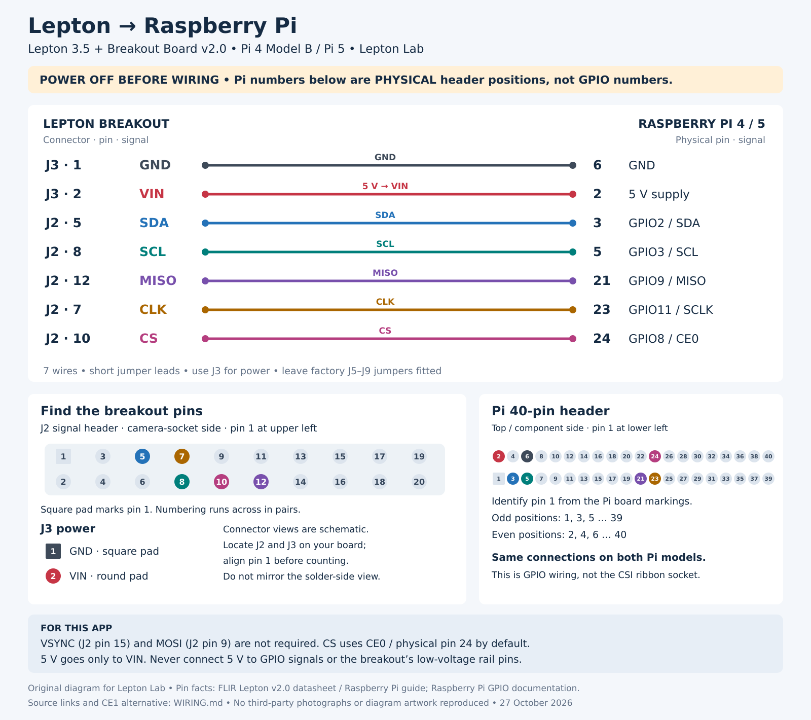

# Lepton Lab

A desktop application for viewing, recording and comparing FLIR Lepton 3.5 thermal-camera data on Raspberry Pi 4 Model B and Raspberry Pi 5.

## Start here

1. [Connect the camera](WIRING.md).
2. [Install and run](INSTALL.md).
3. [Use the controls and read recordings](USER_GUIDE.md).

## Connection overview

[](WIRING.md)

## What it does

- Live 160 × 120 thermal image with ironblack, grayscale or heat colours.
- Automatic contrast or a fixed display range.
- Mean, minimum, maximum and standard deviation for a selected area or pixel.
- A 30-frame reference baseline and a view of changes relative to it.
- Internal-shutter flat-field correction (FFC).
- Raw-frame recording with timestamps, measurements and session metadata.
- Demo mode without a camera.

Measurements are raw counts, not verified degrees Celsius. Temperature conversion requires checking the camera's radiometry and TLinear settings. Palette and contrast changes affect only the display.

## Requirements

- FLIR Lepton 3.5 and FLIR Lepton Breakout Board v2.0 (250-0577-00).
- Raspberry Pi 4 Model B or Pi 5, with Raspberry Pi OS Desktop.
- SPI enabled for images and I²C enabled for FFC.
- A desktop session, locally or through Raspberry Pi Connect.

This is a Linux desktop application, not Arduino, ESP32 or Raspberry Pi Pico firmware. The installer provides the compiler and Python dependencies.

## Run an installed copy

For the Git installation described in this repository:

```bash
cd ~/lepton-lab-github
bash start.sh
```

Close other camera viewers first. No reinstall is needed after restarting the Pi.

## Recordings

Sessions are saved under `~/LeptonRecordings/` unless you select another destination. Each contains raw frames, a CSV measurement log, metadata and, when used, a baseline. Full-rate recording uses approximately 1.2 GB/hour at 8.6 delivered frames/s. Scheduled or interval recording is not implemented.

See the [recording format and reader examples](USER_GUIDE.md#recording-format).

## Status

Developed for the author's Pi 5 setup. Live camera operation on Pi 4 Model B was confirmed by the author on 27 October 2026 after reconnecting the wiring. This is a practical compatibility report, not comprehensive hardware or temperature-accuracy validation.

The application expects 160 × 120 raw video with telemetry disabled. It does not configure camera output modes. Automatic FFC events are not logged, and delivery of every sensor frame is not guaranteed.

## Licence and attribution

Original contributions use the [BSD-2-Clause licence](LICENSE). GroupGets / Pure Engineering palette notices are retained in [GROUPGETS-LICENSE.txt](GROUPGETS-LICENSE.txt). See [THIRD_PARTY_NOTICES.md](THIRD_PARTY_NOTICES.md) and [FLIR-SDK-NOTICES.txt](FLIR-SDK-NOTICES.txt) for other source references and retained terms.

Lepton Lab is not an official FLIR or GroupGets product.
